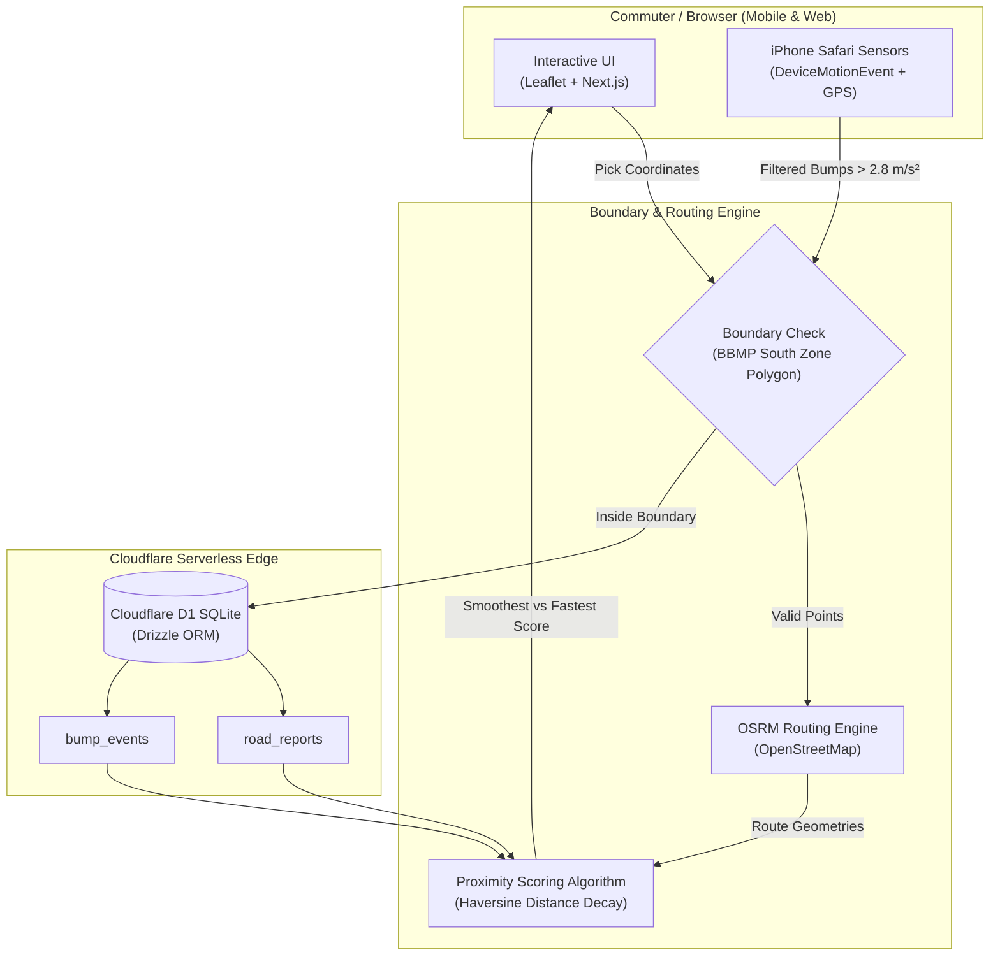

<div align="center">

# 🛵 Namma Smooth Roads
### *BBMP South Zone Two-Wheeler Route & Road Comfort Intelligence*

[](https://namma-smooth-south.feybread16.chatgpt.site/)
[](https://github.com/avinasharadya88/navigate)
[](https://openai.com)
[](https://nextjs.org/)
[](https://developers.cloudflare.com/d1/)
[](https://www.openstreetmap.org/)

<p align="center">
  <strong>"Choose the ride your back will thank you for."</strong>
</p>

<p align="center">
  <a href="https://namma-smooth-south.feybread16.chatgpt.site/"><strong>🚀 Launch Live Application</strong></a> •
  <a href="#-the-problem">The Problem</a> •
  <a href="#-key-features">Key Features</a> •
  <a href="#-how-it-works">How It Works</a> •
  <a href="#-system-architecture">Architecture</a> •
  <a href="#-privacy-by-design">Privacy</a> •
  <a href="#-getting-started">Getting Started</a>
</p>

---

</div>

## 🌐 Live Web App

> **Experience the app directly in your browser:**  
> 👉 **[https://namma-smooth-south.feybread16.chatgpt.site/](https://namma-smooth-south.feybread16.chatgpt.site/)**

*Optimized for mobile and desktop browsers across the official Bruhat Bengaluru Mahanagara Palike (BBMP) South Zone.*

---

## 💡 The Problem

Traditional navigation platforms (Google Maps, Apple Maps) optimize almost exclusively for **travel time** or **shortest distance**. For two-wheeler commuters in Bengaluru:

- Saving 2 minutes often routes riders through cracked lanes, broken asphalt, severe potholes, and unpaved detours.
- Prolonged daily exposure to road shock leads to chronic lower-back pain, spinal fatigue, and vehicle suspension wear.
- There has been no unified, community-driven way to choose road **comfort** over raw speed.

**Namma Smooth Roads** introduces **Comfort-Aware Route Intelligence**: an open-data, crowdsourced system that benchmarks route travel time against road quality so riders can choose the smoothest path home.

---

## ✨ Key Features

### 1. 🗺️ Route Intelligence: Smoothest vs. Fastest
- **Dual-Route Benchmark**: Simultaneously computes the standard fastest route and the smoothest alternative using OpenStreetMap and OSRM.
- **Dynamic Comfort Score (0–100)**: Evaluates road roughness penalties and motion signals along the route corridor.
- **Interactive Leaflet Map**: Visualizes full route geometries, road condition alerts, and South Zone boundaries with intuitive tap-to-pin controls.

### 2. ⚠️ Anonymous Road Condition Reporting
- **1-Tap Pinning**: Tap any spot on the map or click **"Use my current location"** to flag road hazards.
- **Severity Classifications**:
  - 🟡 **Rough**: Uneven surfaces, minor bumps, worn tarmac (*Penalty: 8*)
  - 🟠 **Bumpy**: Deep potholes, speed-breaker clusters, broken patches (*Penalty: 15*)
  - 🔴 **Not Drivable**: Major excavation, waterlogging, or blocked roads (*Penalty: 35*)
- **Frictionless & Anonymous**: Zero sign-ups, no photos, no phone numbers, and no accounts required.

### 3. 📱 Foreground iPhone Motion & Bump Sensing
- **Turn Your Commute into Road Data**: Mount your phone on your handlebar and tap **"Start ride"** in Mobile Safari.
- **Real-Time Sensor Processing**: Analyzes real-time accelerometer and gyroscope data via `DeviceMotionEvent` with gravity compensation.
- **Intelligent Bump Filter**: Identifies acceleration spikes (> 2.8 m/s²), logging bump intensity, GPS speed, and coordinates.
- **Battery & Safety Minded**: Operates completely in the foreground without draining battery in the background; riders are prompted to set up before moving.

### 4. 📊 Operations & Ward Road Quality Pulse
- **Live Observability**: Real-time breakdown of total community reports, passive vibration signals, and critical "Not drivable" alerts.
- **Recent Feed**: Transparent log of recent observations with timestamps and condition markers.
- **Context-Aware Analytics**: Ensures low speeds caused by traffic or signals are never incorrectly flagged as poor road quality.

---

## 🛠️ How It Works



### Proximity Scoring Formula
1. When multiple route alternatives are returned by OSRM, the application samples coordinates along the route geometry.
2. For every community report within **90 meters**, a severity penalty is applied (Rough: -8, Bumpy: -15, Not Drivable: -35).
3. For every vibration signal within **70 meters**, an intensity-weighted penalty is calculated:
   $$\text{Penalty}_{\text{bump}} = \min(8, \max(1, \text{intensity} - 2))$$
4. The final Comfort Score is normalized on a **5 to 100** scale, with the smoothest path surfaced prominently.

---

## 🛡️ Privacy by Design

We believe community infrastructure data should never compromise personal privacy:
- **No User Accounts**: No logins, email addresses, phone numbers, or passwords.
- **No Route Trails**: Continuous rider GPS paths are **never** recorded, streamed, or stored.
- **Discrete Event Uploads Only**: Only specific bump events exceeding vibration thresholds are uploaded with rounded coordinates.
- **Ephemeral Sessions**: A random UUID session identifier is generated per ride session and discarded upon completion.

---

## 🏗️ Tech Stack

| Layer | Technology | Description |
|---|---|---|
| **Frontend Framework** | **Next.js 15 & React 19** | Modern App Router, TypeScript, React Server Components |
| **Styling & UI** | **Tailwind CSS & shadcn/ui** | Clean, responsive design with Lucide icons |
| **Maps & Geospatial** | **Leaflet & OpenStreetMap** | Interactive mapping, GeoJSON boundary styling |
| **Routing** | **OSRM (Project OSRM)** | Community routing engine for two-wheelers |
| **Database** | **Cloudflare D1** | Serverless SQLite edge database |
| **ORM & Migrations** | **Drizzle ORM** | Type-safe schema definition and query builder |
| **Deployment / Cloud** | **Cloudflare Workers / Vite** | Sub-second cold starts and global edge deployment |
| **AI Assisted Dev** | **OpenAI Codex** | Built and iterated with AI-driven development workflows |

---

## 📂 Project Structure

```text
navigate/
├── app/
│   ├── api/
│   │   ├── bumps/route.ts      # API endpoint for sensor bump events
│   │   └── reports/route.ts    # API endpoint for crowdsourced reports
│   ├── globals.css             # Base styles and map animations
│   ├── layout.tsx              # Root HTML wrapper and metadata
│   └── page.tsx                # Main single-page application & map controller
├── components/                 # UI components and shadcn/ui primitives
├── db/
│   ├── index.ts                # Drizzle ORM client initialization
│   └── schema.ts               # SQLite tables (road_reports, bump_events)
├── drizzle/                    # Generated database migrations
├── lib/
│   ├── south-zone.ts           # Turf/geospatial boundary validation helpers
│   └── utils.ts                # Tailwind class utility helpers
├── public/
│   ├── data/
│   │   └── bbmp-south-zone.geojson  # Official BBMP South Zone 2022 Polygon
│   └── favicon.svg             # Application branding icon
├── scripts/                    # Environment, D1, and build runners
└── drizzle.config.ts           # Drizzle Kit configuration
```

---

## 🚀 Getting Started

### Prerequisites
- **Node.js**: `v22.13.0` or later
- **npm**: `v10` or later

### Installation

1. **Clone the repository:**
   ```bash
   git clone https://github.com/avinasharadya88/navigate.git
   cd navigate
   ```

2. **Install dependencies:**
   ```bash
   npm install
   ```

3. **Initialize the local D1 database:**
   ```bash
   node --import ./scripts/sites-env.mjs ./node_modules/wrangler/bin/wrangler.js d1 execute DB --local --config dist/server/wrangler.json --persist-to .wrangler/state --file drizzle/0000_true_daredevil.sql
   ```

4. **Run the local development server:**
   ```bash
   npm run dev
   ```

5. **Open in browser:**
   Open [http://localhost:3000](http://localhost:3000) (or the URL printed in the terminal).

---

## 📊 Data Attribution & Open Data

- **BBMP South Zone Boundary (2022)**: Published via [OpenCity.in](https://opencity.in) and Karnataka State Remote Sensing Applications Centre (KSRSAC).
- **Basemap & Roads**: [OpenStreetMap](https://www.openstreetmap.org/) contributors (ODbL).
- **Routing Engine**: [Project OSRM](https://project-osrm.org/).

---

## 🗺️ Future Roadmap

- [ ] Support for additional BBMP zones (East, West, Mahadevapura, Bommanahalli, etc.).
- [ ] Native background sensor logging app (iOS CoreMotion & Android Activity Recognition).
- [ ] Integration with real-time Bengaluru traffic layers.
- [ ] Exportable ward-level road quality reports for civic and BBMP road repair teams.
- [ ] Multilingual support (ಕನ್ನಡ / Kannada interface toggle).

---

<div align="center">
  <sub>Built with ❤️ for Bengaluru riders. Developed with OpenAI Codex.</sub>
</div>
