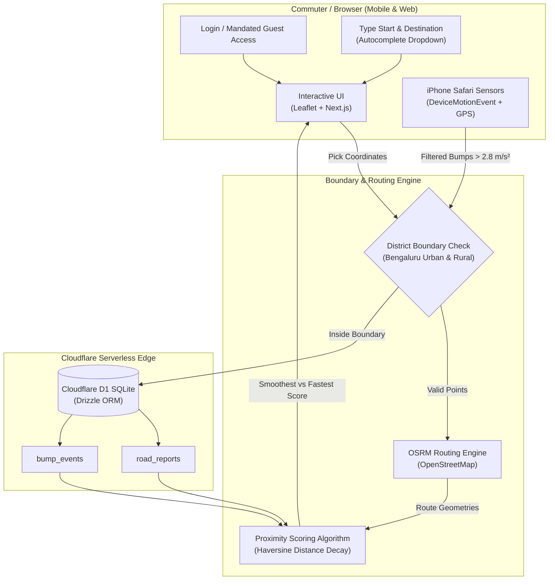

<div align="center">

# 🛵 Namma Smooth Roads
### *Bengaluru Urban & Rural Districts Two-Wheeler Route & Road Comfort Intelligence*

[](https://namma-smooth-south.feybread16.chatgpt.site/)
[](https://github.com/avinasharadya88/navigate)
[](https://openai.com)
[](https://nextjs.org/)
[](https://developers.cloudflare.com/d1/)
[](https://www.openstreetmap.org/)

<p align="center">
  <strong>"Choose the ride your back will thank you for."</strong>
</p>

<p align="center">
  <a href="https://namma-smooth-south.feybread16.chatgpt.site/"><strong>🚀 Launch Live Application</strong></a> •
  <a href="#-the-problem">The Problem</a> •
  <a href="#-key-features">Key Features</a> •
  <a href="#-how-it-works">How It Works</a> •
  <a href="#-system-architecture">Architecture</a> •
  <a href="#-privacy-by-design">Privacy</a> •
  <a href="#-getting-started">Getting Started</a>
</p>

---

</div>

## 🌐 Live Web App

> **Experience the app directly in your browser:**  
> 👉 **[https://namma-smooth-south.feybread16.chatgpt.site/](https://namma-smooth-south.feybread16.chatgpt.site/)**

*Optimized for mobile and desktop browsers across the official Bengaluru Urban and Bengaluru Rural Districts.*

---

## 💡 The Problem

Traditional navigation platforms (Google Maps, Apple Maps) optimize almost exclusively for **travel time** or **shortest distance**. For two-wheeler commuters in Bengaluru:

- Saving 2 minutes often routes riders through cracked lanes, broken asphalt, severe potholes, and unpaved detours.
- Prolonged daily exposure to road shock leads to chronic lower-back pain, spinal fatigue, and vehicle suspension wear.
- There has been no unified, community-driven way to choose road **comfort** over raw speed.

**Namma Smooth Roads** introduces **Comfort-Aware Route Intelligence**: an open-data, crowdsourced system that benchmarks route travel time against road quality so riders can choose the smoothest path home.

---

## ✨ Key Features

### 1. 🔑 Login Portal with Mandated Guest User Access
- **Guest-First Experience**: Mandated guest mode allows immediate, 1-click access without sign-up or delay.
- **Placeholder Credentials**: Includes a demo credential login (`commuter@namma-roads.in` / `smoothroads2026`) with 1-click autofill.
- **Session Persistence**: Remembers active session across reloads with reactive multi-tab sync.

### 2. 🔤 Typed Location Selection (Start & Destination)
- **Interactive Autocomplete**: Type to search across 60+ key Bangalore localities, hubs, and towns (Majestic, Indiranagar, Whitefield, Electronic City, Yelahanka, Nelamangala, BLR Airport, Hosakote, Doddaballapura, Anekal).
- **District Badges**: Clear badges denoting Bengaluru Urban vs. Bengaluru Rural.
- **Swap & GPS Controls**: 1-click swap button to reverse origin/destination and GPS buttons to pin current location.

### 3. 🗺️ Expanded District Map (Bengaluru Urban & Rural)
- **Dual-District Coverage**: Completely expanded map encompassing both Bengaluru Urban and Bengaluru Rural districts.
- **District Boundary Overlays**: Visualizes official district polygons with interactive tooltips and auto-bounding.
- **Dual-Route Benchmark**: Simultaneously computes the standard fastest route and the smoothest alternative using OpenStreetMap and OSRM.
- **Dynamic Comfort Score (0–100)**: Evaluates road roughness penalties and motion signals along the route corridor.

### 4. 🛣️ Road Condition Reporting with Searchable Road Dropdown
- **Road Name Autocomplete Dropdown**: Searchable catalogue of 50+ major Bangalore highways, ring roads, arterials, and main roads (Outer Ring Road, Hosur Road, Airport Expressway NH 44, Tumkur Road, Old Madras Road, SH 9, NICE Road, etc.).
- **Auto-Coordinate Pinning**: Selecting a road automatically pins the map to the road's coordinates if not yet tapped.
- **Severity Classifications**:
  - 🟡 **Rough**: Uneven surfaces, minor bumps, worn tarmac (*Penalty: 8*)
  - 🟠 **Bumpy**: Deep potholes, speed-breaker clusters, broken patches (*Penalty: 15*)
  - 🔴 **Not Drivable**: Major excavation, waterlogging, or blocked roads (*Penalty: 35*)

### 5. 📱 Foreground iPhone Motion & Bump Sensing
- **Turn Your Commute into Road Data**: Mount your phone on your handlebar and tap **"Start ride"** in Mobile Safari.
- **Real-Time Sensor Processing**: Analyzes real-time accelerometer and gyroscope data via `DeviceMotionEvent` with gravity compensation.
- **Intelligent Bump Filter**: Identifies acceleration spikes (> 2.8 m/s²), logging bump intensity, GPS speed, and coordinates.

### 6. 📊 District Operations View
- **Live Observability**: Real-time breakdown of total community reports, passive vibration signals, and critical "Not drivable" alerts.
- **Recent Feed**: Transparent log of recent observations with timestamps and condition markers across both districts.

---

## 🛠️ How It Works



---

## 📍 Data Sources

- **Bengaluru Urban & Rural District Boundaries**: KSRSAC / Survey of India (stored in `public/data/bangalore-districts.geojson`)
- **Basemap & Road Geometries**: OpenStreetMap contributors
- **Routing Engine**: Project OSRM community driving profile

---

## 💻 Run Locally

Requirements: **Node.js 20 or later** and **npm**.

```bash
# 1. Install dependencies
npm install

# 2. Build production assets
npm run build

# 3. Start development server
npm run dev
```

To run local database migrations:
```bash
node --import ./scripts/sites-env.mjs ./node_modules/wrangler/bin/wrangler.js d1 execute DB --local --config dist/server/wrangler.json --persist-to .wrangler/state --file drizzle/0000_true_daredevil.sql
```
