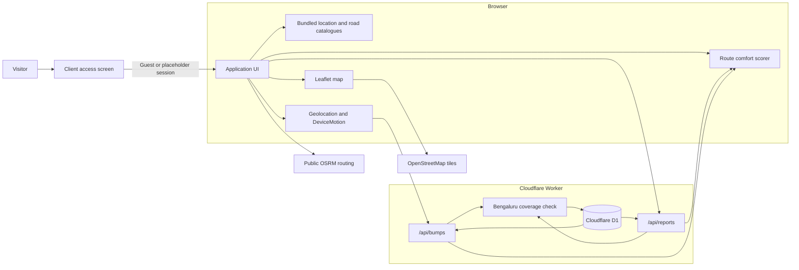

# Namma Smooth Roads: architecture

Implementation reviewed at commit `b769624` on 11 October 2026. Product behavior and acceptance criteria are in [PRD.md](PRD.md).

## 1. System overview

Namma Smooth Roads is a single-page React application with two JSON API routes and a Cloudflare D1 database. Most interaction logic runs in the browser: the access screen, location and road search, Leaflet map, route scoring, and motion sensing.



The access screen is a client-side product flow. It does not protect the Worker APIs.

## 2. Stack

| Layer | Repository version or implementation |
| --- | --- |
| UI | React 19.2.6, Next.js 16.3.4 App Router conventions |
| Theming | next-themes 0.4.6 with ThemeProvider, class-based attribute, and system synchronization |
| Design System | Google Stitch AeroNav PRO Spatial Navigation HUD (Inter & JetBrains Mono typography, deep surface elevation tokens `#0e0e10`–`#39393b`, 3D viewport perspective tilt, radar overlay, cybernetic telemetry badges) |
| Runtime and build | vinext 1.0.0-beta.5 on Vite 8.0.13 |
| Hosting | Cloudflare Workers through `@cloudflare/vite-plugin` |
| Database | Cloudflare D1 with Drizzle ORM 0.45.2 |
| Map | Leaflet 1.9.4 |
| Language | TypeScript 5.9.3 |
| Icons | lucide-react |
| Required Node version | 22.13.0 or later |

The tracked `.openai/hosting.json` binds D1 as `DB`. Production injects the database binding. Local commands use the Sites environment helper and Wrangler state under `.wrangler/state`.

## 3. Relevant repository layout

```text
app/
  api/reports/route.ts          read and create road reports
  api/bumps/route.ts            read and create bump events
  page.tsx                      application state, full-canvas map, spatial HUD, scoring, sensors
  layout.tsx                    document metadata, fonts (Inter, JetBrains Mono), ThemeProvider
  globals.css                   Google Stitch design tokens, 3D viewport, radar animations, tile shaders
components/
  theme-provider.tsx            next-themes client context provider
  theme-switcher.tsx            Google Stitch segmented pill theme switcher
  login-view.tsx                guest and placeholder credential screen with Stitch cyber container
  location-search-input.tsx     typed start and destination search with Stitch elevation
  road-search-input.tsx         report road search with Stitch elevation
db/
  index.ts                      D1 client
  schema.ts                     report and bump tables
drizzle/
  0000_true_daredevil.sql       initial migration
lib/
  bangalore-data.ts             77 locations and 58 roads
  bangalore-bounds.ts           point acceptance logic
  bangalore-districts.json      server and client boundary data
  south-zone.ts                 compatibility exports
public/data/
  bangalore-districts.geojson   map boundary overlay
scripts/
  generate-bangalore-geojson.mjs  regenerates both boundary files
```

`lib/south-zone.ts` remains as a compatibility layer. Its `isInsideSouthZone` export now aliases `isInsideBangalore`, so the existing API import paths accept the expanded coverage.

## 4. Access state

`Home` reads the browser key `nsr_user_session` with `useSyncExternalStore`. A storage event subscription keeps other tabs in sync.

The stored object has this shape:

```ts
type AuthUser = {
  name: string;
  role: "guest" | "commuter";
  email?: string;
};
```

When there is no stored user, `Home` returns `LoginView` and does not render the application shell. Guest access stores `{ name: "Guest Rider", role: "guest" }`. Placeholder sign-in derives the display name from the submitted email and stores the email locally.

There is no authentication endpoint, token, signed cookie, or server-side session. The placeholder form accepts any password of four or more characters, and blank fields use the displayed demo values. Logout removes the local value.

## 5. Apple design system and theme architecture

The app incorporates the Apple Human Interface Guidelines design system:

### 5.1 Appearance modes & theme switching
- **Provider**: `ThemeProvider` in `app/layout.tsx` wraps the document using `next-themes` with `attribute="class"`, `defaultTheme="system"`, and `enableSystem={true}`.
- **Modes**:
  - **Light mode (`.light`)**: `#F5F5F7` background, elevated white surfaces, subtle hairline borders (`rgba(0, 0, 0, 0.08)`), and high-contrast typography.
  - **Dark mode (`.dark`)**: True OLED black (`#000000`), elevated dark cards (`#1C1C1E`), vibrant semantic green/blue/orange accents, and dark-mode map tile shader inversion.
  - **System default**: Evaluates the OS-level `prefers-color-scheme` in real-time.
- **Segmented switcher (`ThemeSwitcher`)**: Uses `useSyncExternalStore` for hydration-safe rendering to prevent server/client mismatches, providing interactive pill buttons for Light, Dark, and System modes.

### 5.2 Materials and micro-interactions
- **Materials**: Frosted glass panels (`backdrop-filter: blur(24px) saturate(190%)`) applied to topbar, dropdowns, and floating map widgets.
- **Geometry**: Continuous squircle curvature (`border-radius: 12px` to `24px`), tactile touch states (`active:scale-[0.985]`), and multi-layer soft drop shadows.
- **Map Dark Mode**: `.dark .map .leaflet-tile-pane` utilizes CSS filter transformations (`invert(100%) hue-rotate(180deg) brightness(88%) contrast(92%) saturate(75%)`) to present OpenStreetMap raster tiles as high-contrast Apple Maps dark tiles.

## 6. Typed location selection

`LocationSearchInput` receives the selected coordinate and label from `Home`. It filters `BANGALORE_LOCATIONS` by:

- display name;
- area;
- district;
- aliases.

The first eight matches are displayed. With an empty query, the first eight catalogue entries appear as suggestions. Each result contains a stored latitude and longitude. Selecting a result updates the corresponding point and clears existing route results.

Keyboard behavior:

- Arrow Down and Arrow Up move the highlighted option.
- Enter selects the highlighted option.
- Escape closes the dropdown.
- Clicking outside closes the dropdown.

The start input exposes a GPS control. Map clicks remain available for either point. `findClosestLocation` assigns the nearest catalogue label to a map-selected point when the nearest entry is within 1.6 kilometres; otherwise the UI shows rounded coordinates.

The catalogue is local data, not geocoding. Free text alone does not create a coordinate.

## 7. Road search for reports

`RoadSearchInput` filters `BANGALORE_ROADS` by road name, corridor, and district. An empty query displays the full catalogue. Results are grouped only by their existing order and show an Urban, Rural, or Both badge.

Selecting a result:

1. fills the report label;
2. closes the dropdown;
3. pins the stored representative coordinate when no report point exists.

The rider can then tap the map to refine the point. Custom labels remain valid because the component passes any typed value to `roadLabel` even when the filtered list is empty.

## 8. Map and geographic validation

`AppMap` dynamically imports Leaflet so it does not run during server rendering. It loads OpenStreetMap tiles, then fetches `/data/bangalore-districts.geojson`.

The GeoJSON has three features:

- a Bengaluru Urban polygon;
- a Bengaluru Rural multipolygon with four component areas;
- a combined outer perimeter.

The map styles Urban and Rural separately, binds district tooltips, and fits to the complete layer. If the file cannot load, the map falls back to the rectangle from 12.60 to 13.50 latitude and 77.15 to 77.95 longitude.

`isInsideBangalore` first checks the broader bounding box from 12.50 to 13.56 latitude and 77.05 to 78.02 longitude. It then checks the outer ring of each Polygon or MultiPolygon feature. If no polygon matches, it accepts points inside a second fallback envelope from 12.52 to 13.54 latitude and 77.12 to 77.98 longitude.

This fallback makes the accepted area larger than the drawn district shapes. The generated coordinates are simplified. Replace both bundled files with authoritative geometry and remove the fallback before treating the check as an exact district boundary.

`scripts/generate-bangalore-geojson.mjs` writes the same data to:

- `public/data/bangalore-districts.geojson` for the map;
- `lib/bangalore-districts.json` for validation.

## 9. Route comparison and scoring

The browser requests:

```text
https://router.project-osrm.org/route/v1/driving/{startLng},{startLat};{endLng},{endLat}?alternatives=true&overview=full&geometries=geojson&steps=false
```

The public OSRM response supplies geometry, duration, and distance. The browser scores each alternative against the reports and bump events already loaded from D1.

For a route with coordinate list `C`:

```text
sample stride = max(1, floor(length(C) / 160))
score = 100

for each report within 90 m of a sampled coordinate:
    subtract 8 for rough
    subtract 15 for bumpy
    subtract 35 for not_drivable

for each bump within 70 m of a sampled coordinate:
    subtract min(8, max(1, intensity - 2))

score = max(5, round(score))
```

Routes sort by score descending, then duration ascending. The fastest route is calculated separately by minimum duration.

The distance check uses sampled vertices, not line segments. It can miss an observation that is close to a long segment but farther from the sampled vertices.

## 10. Road reports API

### `GET /api/reports`

Returns the newest 300 rows ordered by `created_at` descending.

### `POST /api/reports`

Accepts latitude, longitude, severity, road label, and note. It requires finite coordinates that pass `isInsideSouthZone`, whose implementation now delegates to the expanded Bengaluru check. Severity must be `rough`, `bumpy`, or `not_drivable`.

The road label is trimmed to 100 characters and the note to 240. A successful insert returns the created report with status 201.

## 11. Bump events API

### `GET /api/bumps`

Returns the newest 500 rows ordered by `created_at` descending. The current selection returns every table column, including `session_id`.

### `POST /api/bumps`

Accepts an `events` array and processes at most 40 entries. An event requires finite coordinates, finite intensity, a non-empty session ID, and a point accepted by the expanded Bengaluru check.

The API clamps:

- intensity to an absolute maximum of 30;
- speed to 0 through 140 km/h;
- GPS accuracy to 0 through 500 metres.

If no entry survives validation, the endpoint returns status 400. Otherwise it inserts the valid events and returns the accepted count with status 201.

## 12. Ride sensing

The browser requests high-accuracy geolocation and listens for `devicemotion`. On iOS it calls `DeviceMotionEvent.requestPermission()` when available.

Intensity is the magnitude of `event.acceleration`. If that value is unavailable, the app subtracts standard gravity from the magnitude of `accelerationIncludingGravity`.

An event is sent only when intensity is at least 2.8 m/s², accuracy is 80 metres or better, the accepted boundary contains the point, and 2.5 seconds have elapsed since the last event. Coordinates are rounded to five decimal places before upload.

Each accepted event is a separate request. There is no local queue, retry buffer, or background worker. Lost connectivity can therefore drop sensor events.

## 13. Data model

```text
road_reports
  id           integer primary key
  latitude     real not null
  longitude    real not null
  severity     text not null
  road_label   text not null
  note         text not null
  created_at   text not null

bump_events
  id           integer primary key
  latitude     real not null
  longitude    real not null
  intensity    real not null
  speed_kph    real
  accuracy_m   real
  session_id   text not null
  created_at   text not null
```

There are no spatial or timestamp indexes. Current queries read the newest fixed number of rows, while route proximity calculations happen in the browser.

## 14. Security and privacy boundaries

The local access screen is not an authorization boundary. Both APIs accept requests without a session, and the Worker never reads `nsr_user_session`.

Reports contain no user identifier. Bump events contain a random per-ride session ID, but the public GET response exposes that ID with timestamps. A caller can group the returned events into a rough ride sequence. Remove `session_id` from public output or rotate it more frequently before broader testing.

Report coordinates are not rounded on the server. Bump coordinates are rounded only by the browser, so a direct API caller can send more precise coordinates.

Neither write endpoint has rate limiting, duplicate detection, moderation, or deletion support.

## 15. External dependencies

| Service | Use | Current limitation |
| --- | --- | --- |
| OpenStreetMap tile server | Basemap | Public tile usage limits apply |
| Project OSRM public server | Route alternatives | Demo service, car profile, no uptime guarantee |
| Browser Geolocation API | GPS position and speed | Requires permission and device support |
| DeviceMotion API | Bump intensity | Requires permission on iOS and an open foreground page |

The location and road dropdowns make no external request.

## 16. Build and local development

```bash
git clone https://github.com/avinasharadya88/navigate.git
cd navigate
npm install
npm run build
npm run dev
```

The development server listens on port 5173 by default.

Initialize the local D1 database after the build has created `dist/server/wrangler.json`:

```bash
node --import ./scripts/sites-env.mjs ./node_modules/wrangler/bin/wrangler.js d1 execute DB --local --config dist/server/wrangler.json --persist-to .wrangler/state --file drizzle/0000_true_daredevil.sql
```

Real motion testing requires a supported phone browser and a secure origin.

## 17. Recommended technical work

1. Replace the generated coverage shapes and fallback envelope with authoritative district geometry.
2. Decide whether the access page remains guest-only or becomes real authentication. If authentication is added, enforce it on both API routes.
3. Remove `session_id` from public bump responses and round coordinates on the server.
4. Add rate limiting, duplicate suppression, and moderation.
5. Move route scoring and geographic utilities into tested modules.
6. Add evidence age, per-location penalty caps, and a separate confidence measure.
7. Replace public OSRM with a service and profile suitable for two-wheelers.
8. Add a geocoding provider only after deciding its privacy, cost, and licensing requirements.
