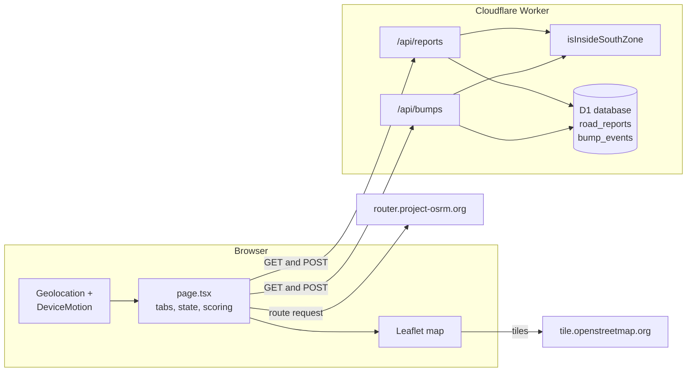

# Namma Smooth Roads: architecture

Written against `main` at commit `6cc3f88`, 11 October 2026. The product side is in [PRD.md](PRD.md). Where this file and the README differ, this file follows the code.

## 1. Overview

It is a single-page app with two small JSON endpoints behind it and a SQLite database at the edge. Almost all of the logic runs in the browser: the map, route scoring and sensor handling. The server has two jobs. It checks that a submitted point is inside the BBMP South Zone, and it stores and returns rows.



Two outside services are called directly from the browser, not through the Worker: OpenStreetMap tiles and the public OSRM server. The Worker never talks to either.

## 2. Stack and build

| Piece | What the repo uses |
| --- | --- |
| UI | React 19.2.6, Next.js 16.3.4 App Router conventions, TypeScript 5.9 |
| Framework runtime | `vinext` 1.0.0-beta.5, which runs Next-style apps on Vite 8 |
| Hosting target | Cloudflare Workers through `@cloudflare/vite-plugin`, Wrangler 4.92 |
| Database | Cloudflare D1 (SQLite), bound as `DB` |
| ORM and migrations | Drizzle ORM 0.45.2, Drizzle Kit 0.31 |
| Map | Leaflet 1.9.4, loaded with a dynamic import so it never runs on the server |
| Styling | Hand-written CSS in `app/globals.css`, Tailwind 4 and shadcn tooling installed |
| Icons | lucide-react |
| Node | 22.13.0 or later |

The README says Next.js 15. `package.json` pins 16.3.4.

The repo started from an OpenAI Codex site scaffold, which explains several folders that the app itself does not use: `build/` (Vite plugins and the worker entry), `scripts/connector-preview/`, `lib/connector-*`, `app/chatgpt-auth.ts`, `components/connector-error.tsx` and `examples/d1/`. `app/page.tsx` imports none of the shadcn components, and the dependencies for charts, forms, carousels and date pickers are installed but unused. They can be removed without touching behavior, though that has not been tried.

`.openai/hosting.json` sets `"d1": "DB"` and `"r2": null`. `vite.config.ts` reads it to declare the D1 binding for local runs, using a placeholder database ID. In production the hosting platform injects the real binding. If `env.DB` is missing, `getDb()` throws with a message about the binding.

### Scripts

| Command | What it does |
| --- | --- |
| `npm run dev` | Runs `vinext dev` on port 5173 through `scripts/run-framework.mjs`. The README says port 3000; the script says 5173. |
| `npm run build` | Builds with vinext, or with `scripts/build-verified.sh` when the execution profile is `managed-linux` |
| `npm run start` | Serves the build with Wrangler in local mode, state kept in `.wrangler/state` |
| `npm run lint` | ESLint |
| `npm run db:generate` | Drizzle Kit generates a migration from `db/schema.ts` |

## 3. Repository layout

```
app/
  api/reports/route.ts   GET and POST road reports
  api/bumps/route.ts     GET and POST bump events
  page.tsx               the whole UI: tabs, map, scoring, sensors (295 lines)
  layout.tsx             HTML shell and metadata
  globals.css            all styles, three responsive breakpoints
db/
  index.ts               getDb(): Drizzle client over the D1 binding
  schema.ts              road_reports and bump_events
drizzle/
  0000_true_daredevil.sql   the only migration
lib/
  south-zone.ts          point-in-polygon check
  south-zone.json        boundary used by that check
public/data/
  bbmp-south-zone.geojson   same boundary, fetched by the map to draw it
```

`lib/south-zone.json` and `public/data/bbmp-south-zone.geojson` are byte-identical (checked with `cmp`). They are two copies of one file, and they have to be updated together. The README lists a "Turf" helper in `lib`; there is no Turf dependency, and the check is hand-written.

`db/schema.ts` still has the scaffold's "Intentionally empty by default" comment and `export {}` above the real table definitions. It is harmless but misleading.

## 4. The client

Everything lives in `app/page.tsx` as one client component, `Home`, plus an `AppMap` component. State is plain React hooks, with no store or data library.

### 4.1 State and data loading

`Home` keeps the active tab, start and destination points, the report point being drafted, the loaded reports and bumps, the scored routes, form fields, a notice string and the ride state. On mount it calls `/api/reports` and `/api/bumps` together with `Promise.allSettled`, so one failing endpoint does not block the other. It refreshes after a ride stops. There is no polling.

### 4.2 Map

`AppMap` creates the Leaflet map once, adds OpenStreetMap tiles, fetches `/data/bbmp-south-zone.geojson`, draws it as a dashed green outline and fits the view to it. A second effect clears and redraws a single layer group whenever start, end, reports, bumps or routes change. It draws:

- start and destination markers;
- routes as polylines, the first (best score) heavier and green, the rest blue;
- reports as circle markers coloured by condition, with a popup;
- ride signals as translucent purple circles whose radius is `min(55, 14 + intensity × 4)` metres.

Report notes go into popup HTML after `<` and `>` are stripped. That is a thin defense, and a good reason to render popup content with DOM nodes instead of strings.

Map clicks go through a ref-held callback, so the Leaflet handler does not need to be re-registered when state changes. A click outside the zone only produces a notice.

### 4.3 Route comparison

```mermaid
sequenceDiagram
    participant R as Rider
    participant P as page.tsx
    participant O as OSRM
    R->>P: tap start, tap destination
    R->>P: Compare routes
    P->>O: GET route/v1/driving/lng,lat;lng,lat<br/>alternatives=true, overview=full, geometries=geojson
    O-->>P: up to several routes
    P->>P: score each route against loaded reports and bumps
    P->>P: sort by score, then duration
    P-->>R: smoothest card, fastest card, polylines
```

Scoring is in the browser, in `scoreRoute`. It uses the data already loaded, so a comparison needs only one network call, to OSRM.

### 4.4 Ride recording

`startRide` runs the sensor pipeline:

1. Check that geolocation and `DeviceMotionEvent` exist. On iOS, call `DeviceMotionEvent.requestPermission()` and stop if it is not granted.
2. Generate a session ID with `crypto.randomUUID()` and reset the counters.
3. `watchPosition` with high accuracy keeps the latest GPS fix in a ref and updates the speed readout (m/s × 3.6).
4. A `devicemotion` listener computes intensity. If `event.acceleration` has all three axes, intensity is its magnitude. Otherwise it is the absolute difference between the magnitude of `accelerationIncludingGravity` and 9.81.
5. An event is dropped unless intensity is 2.8 or more, a position exists, at least 2.5 seconds have passed since the last one, the point is inside the zone and GPS accuracy is 80 m or better.
6. A surviving event is rounded (5 decimals for position, 2 for intensity, 1 for speed and accuracy) and sent alone in `POST /api/bumps`. A failed request is swallowed, and the signal counter has already gone up, so the on-screen count can exceed what was stored.

`stopRide` clears the watch and the listener, then reloads data. An unmount effect does the same cleanup.

Nothing is buffered. Each event is its own request, and losing signal mid-ride loses those events.

## 5. The API

Both routes are Next route handlers that share the same shape. The runtime is the Cloudflare Worker, and every database call goes through `getDb()`.

### `/api/reports`

| Method | Behavior |
| --- | --- |
| `GET` | Newest 300 rows by `created_at`, as `{ reports }` |
| `POST` | Validates and inserts one report, returns `{ report }` with status 201 |

POST rules: latitude and longitude must be finite numbers; the point must pass `isInsideSouthZone`; `severity` must be `rough`, `bumpy` or `not_drivable`; `roadLabel` is trimmed and cut to 100 characters (default "Pinned road location"); `note` is trimmed and cut to 240. Failures return 400 with a message. Anything thrown returns 500 with `error.message`.

### `/api/bumps`

| Method | Behavior |
| --- | --- |
| `GET` | Newest 500 rows by `created_at`, as `{ bumps }`, every column included |
| `POST` | Accepts `{ events: [...] }`, keeps up to the first 40, drops invalid ones, inserts the rest, returns `{ accepted }` with status 201 |

Per-event rules: finite latitude, longitude and intensity; a non-empty `sessionId` cut to 64 characters; inside the zone. Intensity is stored as its absolute value capped at 30. Speed is clamped to 0 to 140 km/h and accuracy to 0 to 500 m, and either becomes null if it is not a number. If no event survives, the response is 400.

There is no authentication, no rate limit and no request size check beyond the 40-event slice.

## 6. Data model

```
road_reports
  id          integer, primary key, autoincrement
  latitude    real, not null
  longitude   real, not null
  severity    text, not null   ("rough" | "bumpy" | "not_drivable", enforced in Drizzle, not by a SQL check)
  road_label  text, not null, default 'Pinned road location'
  note        text, not null, default ''
  created_at  text, not null, default CURRENT_TIMESTAMP

bump_events
  id          integer, primary key, autoincrement
  latitude    real, not null
  longitude   real, not null
  intensity   real, not null
  speed_kph   real
  accuracy_m  real
  session_id  text, not null
  created_at  text, not null, default CURRENT_TIMESTAMP
```

`drizzle/0000_true_daredevil.sql` creates both tables. There are no indexes. Today every query reads the newest N rows, so that is fine, but any location-based query will scan the table.

`CURRENT_TIMESTAMP` produces UTC text like `2026-10-11 15:46:00` with no timezone marker. The Operations tab passes it to `new Date()`, which most browsers read as local time. The visible effect is a date that can be off near midnight.

## 7. Geofence

`lib/south-zone.ts` imports `south-zone.json`, which holds one `MultiPolygon` feature named "BBMP South Zone". `isInsideSouthZone(lat, lng)` runs an even-odd ray-casting test against each polygon's outer ring and excludes points that fall inside a hole. It runs in the browser before a tap or location fix is accepted and again in both API routes, so a client that skips the first check still hits the second. Because the JSON is imported, the whole polygon ships in both the client and server bundles. The map fetches the other copy separately to draw it.

## 8. Scoring algorithm

For a candidate route with coordinates `C` (OSRM GeoJSON, `[lng, lat]`):

```
distanceToRoute(p, C):
    stride = max(1, floor(len(C) / 160))
    return min over C[0], C[stride], C[2*stride], ... of haversine(p, point)

score = 100
for each report r:    if distanceToRoute(r) < 90 m: score -= {rough: 8, bumpy: 15, not_drivable: 35}[r.severity]
for each bump b:      if distanceToRoute(b) < 70 m: score -= min(8, max(1, b.intensity - 2))
score = max(5, round(score))
```

Routes sort by score descending, then duration ascending. Index 0 is "smoothest". "Fastest" is the minimum duration.

Things to know before changing it:

- Distance is measured to sampled vertices, not to segments. At most about 160 points per route are checked, so on a long route with sparse geometry a report can be a little farther from the nearest sampled vertex than from the line itself.
- Cost is routes × (reports + bumps) × about 160 haversine calls. With the current caps (300 and 500) that is cheap. Without caps it would not be.
- The score uses only the rows `GET` returns, so it sees the latest 300 reports and 500 signals and nothing older.
- There is no weighting by age, no deduplication and no ceiling on how much one location can subtract.

## 9. Privacy as implemented

| Claim | What the code does |
| --- | --- |
| No accounts | True. No auth runs in the app. `app/chatgpt-auth.ts` exists from the scaffold and nothing imports it. |
| No continuous trail | True from the phone. Only filtered events are posted. |
| Coordinates rounded | Done in the browser for ride events only. Report coordinates go as the map gave them, and the server rounds neither. |
| Session ID per ride | True, random per ride. But `GET /api/bumps` returns it to anyone, with timestamps, so a ride's events can be grouped and ordered. |
| Inside the zone only | Enforced on the server. |

The session ID exposure is the most important item here. See PRD section 9.

## 10. External dependencies

| Service | Used for | Risk |
| --- | --- | --- |
| `router.project-osrm.org` | Route alternatives, `driving` profile | Public demo server, no uptime promise, car profile, called from the browser |
| `tile.openstreetmap.org` | Basemap tiles | Subject to OSM's tile usage policy at higher traffic |
| OpenCity.in / KSRSAC | Boundary data, bundled in the repo | None at runtime |

## 11. Local development

```
git clone https://github.com/avinasharadya88/navigate.git
cd navigate
npm install
node --import ./scripts/sites-env.mjs ./node_modules/wrangler/bin/wrangler.js d1 execute DB --local --config dist/server/wrangler.json --persist-to .wrangler/state --file drizzle/0000_true_daredevil.sql
npm run dev
```

The D1 command expects `dist/server/wrangler.json`, which is a build output (`dist/` is git-ignored), so run `npm run build` once first. The dev server listens on port 5173 unless the execution profile changes it. Reading device motion needs a real phone over HTTPS, so the Ride tab cannot be fully tested on a desktop.

## 12. Technical debt and suggested order

1. Remove `session_id` from `GET /api/bumps` output and round report coordinates on the server. Both are one-line changes with a large privacy effect.
2. Add rate limiting and basic duplicate suppression to both POST handlers.
3. Move the scoring function out of `page.tsx` into `lib/` and add unit tests. It is the core of the product and has none.
4. Add a time window and a penalty cap at each location.
5. Add a SQL `CHECK` on `severity`, and an index on `created_at` once the tables grow.
6. Replace the public OSRM call with a router that has a two-wheeler profile, ideally behind a Worker route so the client does not depend on a specific host.
7. Delete the unused scaffold code and dependencies, and keep one copy of the boundary file.
8. Fix the README: Next.js version, dev port, the Turf mention and the "two-wheeler" routing claim.
